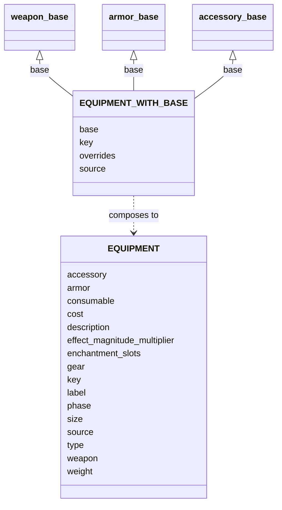
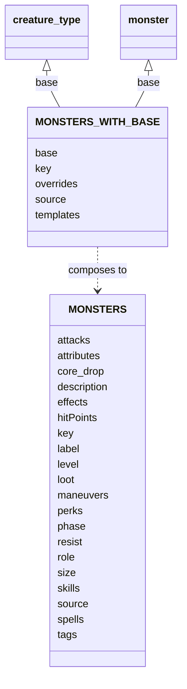
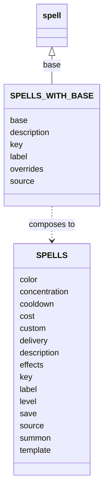
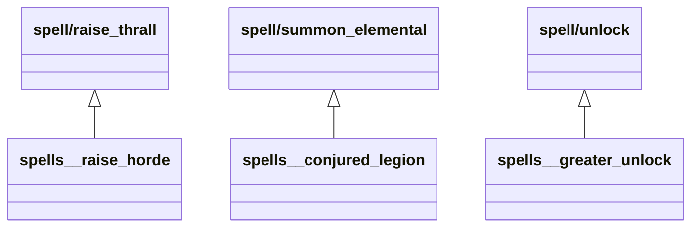
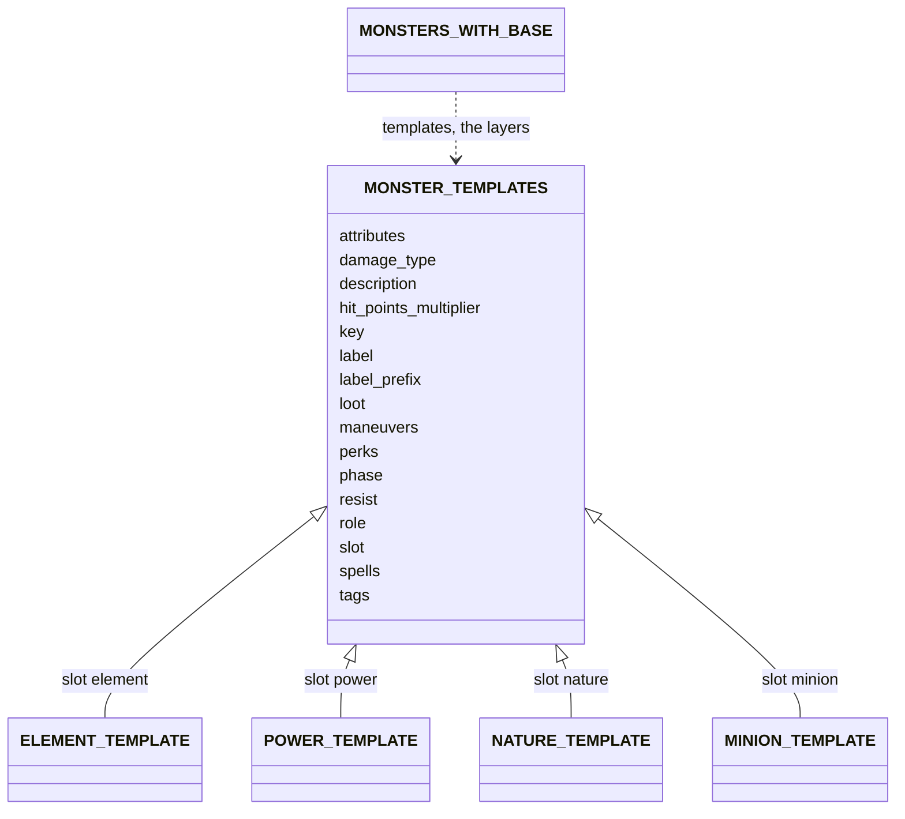

# Composition diagram

Modified: 2026-11-18

Generated by `ruleset/scripts/data_model_diagram.py` from `ruleset/schemas/` and `ruleset/data/`;
do not edit by hand. Run `python ruleset/scripts/data_model_diagram.py --write` after a change,
and `test_data_model_diagram.py` fails until the page matches. The rules:
[composition.md](composition.md).

The [data model diagram](data-model-diagram.md) shows references; this page shows what a row is
built on. A row may be written out whole, or name a `base` and list its `overrides`; the second
composes to the first, so a consumer reads one flat row. An arrow `<|--` runs from a base to what
builds on it.

3 collections compose rows from a base: `equipment`, `monsters`, `spells`.

## Equipment

From `equipment.schema.json`: a row as written, or a row on a base (`weapon_base`, `armor_base`, `accessory_base`).

In the data, 16 rows build on 10 bases; all are drawn, with up to 3 rows each.

```mermaid
classDiagram
    class accessory_base__ring_base["accessory_base/ring_base"]
    accessory_base__ring_base <|-- equipment__ring_of_fire_ward
    accessory_base__ring_base <|-- equipment__ring_of_protection
    accessory_base__ring_base <|-- equipment__ring_of_strength
    note for accessory_base__ring_base "1 more"
    class accessory_base__necklace_base["accessory_base/necklace_base"]
    accessory_base__necklace_base <|-- equipment__cursed_iron_necklace
    accessory_base__necklace_base <|-- equipment__gold_necklace
    accessory_base__necklace_base <|-- equipment__necklace_of_frost_ward
    class accessory_base__amulet_base["accessory_base/amulet_base"]
    accessory_base__amulet_base <|-- equipment__amulet_of_health
    accessory_base__amulet_base <|-- equipment__amulet_of_warding
    class accessory_base__belt_base["accessory_base/belt_base"]
    accessory_base__belt_base <|-- equipment__belt_of_the_ox
    class accessory_base__circlet_base["accessory_base/circlet_base"]
    accessory_base__circlet_base <|-- equipment__circlet_of_insight
    class accessory_base__cloak_base["accessory_base/cloak_base"]
    accessory_base__cloak_base <|-- equipment__cloak_of_shadows
    class accessory_base__earring_base["accessory_base/earring_base"]
    accessory_base__earring_base <|-- equipment__earring_of_the_sage
    class armor_base__chainmail["armor_base/chainmail"]
    armor_base__chainmail <|-- equipment__steel_chainmail
    class weapon_base__longbow["weapon_base/longbow"]
    weapon_base__longbow <|-- equipment__elven_wood_longbow
    class weapon_base__longsword["weapon_base/longsword"]
    weapon_base__longsword <|-- equipment__cursed_iron_longsword
```

## Monsters

From `monster.schema.json`: a row as written, or a row on a base (`creature_type`, `monster`).

In the data, 59 rows build on 20 bases; the 10 most used are drawn, with up to 3 rows each.

```mermaid
classDiagram
    class creature_type__beast["creature_type/beast"]
    creature_type__beast <|-- monsters__acid_hydra
    creature_type__beast <|-- monsters__basilisk
    creature_type__beast <|-- monsters__cave_spider
    note for creature_type__beast "9 more"
    class creature_type__elemental["creature_type/elemental"]
    creature_type__elemental <|-- monsters__ember_drake
    creature_type__elemental <|-- monsters__fire_elemental
    creature_type__elemental <|-- monsters__ice_elemental
    note for creature_type__elemental "4 more"
    class creature_type__undead["creature_type/undead"]
    creature_type__undead <|-- monsters__frost_revenant
    creature_type__undead <|-- monsters__ghoul
    creature_type__undead <|-- monsters__lich_acolyte
    note for creature_type__undead "4 more"
    class creature_type__humanoid["creature_type/humanoid"]
    creature_type__humanoid <|-- monsters__bandit
    creature_type__humanoid <|-- monsters__giant
    creature_type__humanoid <|-- monsters__goblin_skirmisher
    note for creature_type__humanoid "2 more"
    class monster__fire_elemental["monster/fire_elemental"]
    monster__fire_elemental <|-- monsters__acid_elemental
    monster__fire_elemental <|-- monsters__magma_titan
    monster__fire_elemental <|-- monsters__storm_elemental
    note for monster__fire_elemental "1 more"
    class creature_type__familiar["creature_type/familiar"]
    creature_type__familiar <|-- monsters__cat_familiar
    creature_type__familiar <|-- monsters__owl_familiar
    creature_type__familiar <|-- monsters__raven_familiar
    class monster__ooze["monster/ooze"]
    monster__ooze <|-- monsters__acid_ooze
    monster__ooze <|-- monsters__fire_ooze
    monster__ooze <|-- monsters__frost_ooze
    class creature_type__construct["creature_type/construct"]
    creature_type__construct <|-- monsters__iron_sentinel
    creature_type__construct <|-- monsters__stone_golem
    class creature_type__plant["creature_type/plant"]
    creature_type__plant <|-- monsters__bog_shambler
    creature_type__plant <|-- monsters__treant_sapling
    class monster__giant["monster/giant"]
    monster__giant <|-- monsters__frost_giant
    monster__giant <|-- monsters__storm_giant_youth
```

## Spells

From `spell.schema.json`: a row as written, or a row on a base (`spell`).

In the data, 3 rows build on 3 bases; all are drawn, with up to 3 rows each.

## Monster templates

A template is a layer: it changes a monster between its base and its overrides. Each fills one
slot (`element`, `power`, `nature`, `minion`), from `monster_template.schema.json`.

## Perk kinds

Pending M5-58: the features schema has no base perk yet, so the perk kinds are not drawn.
