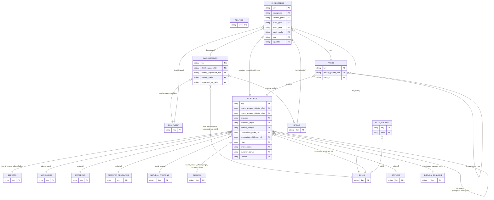
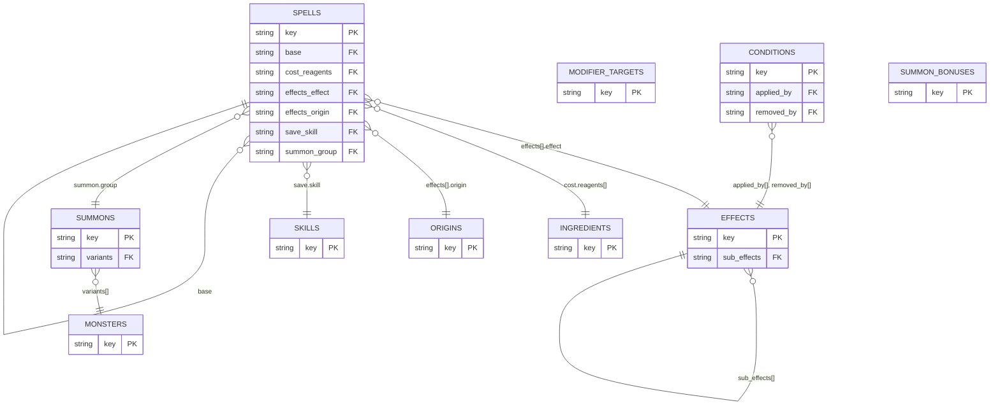
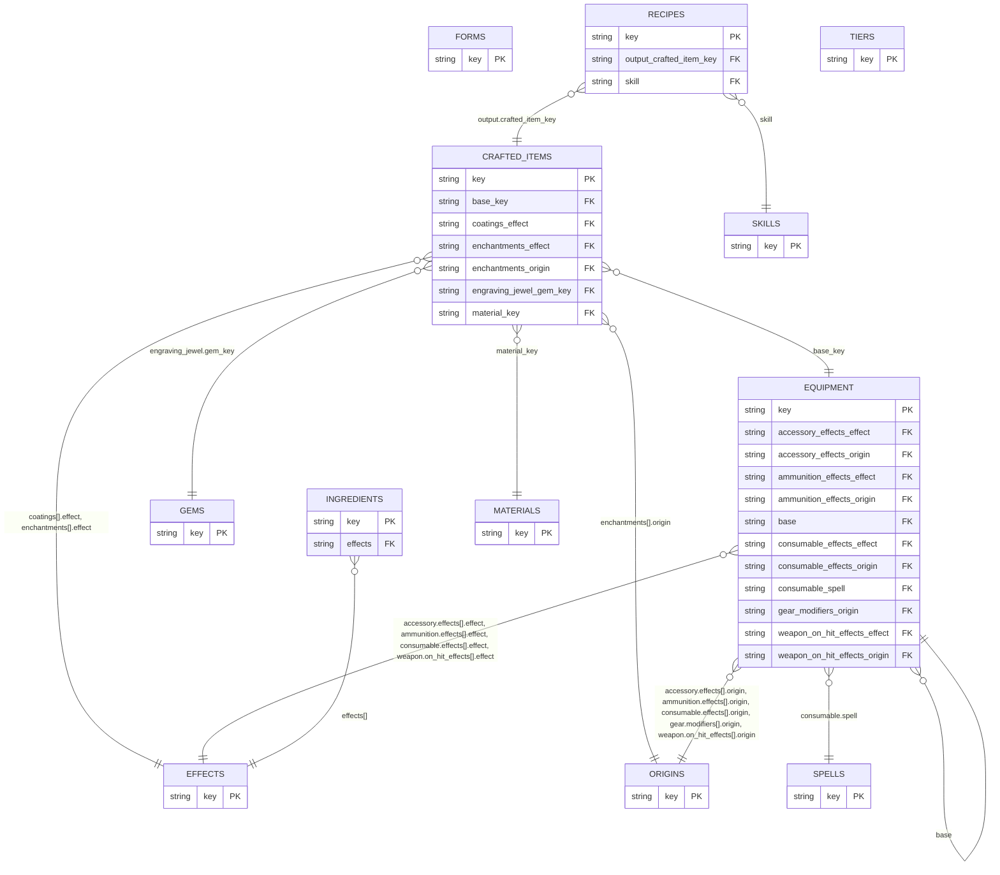
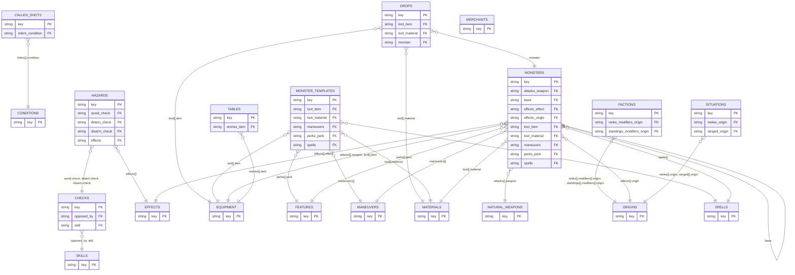

# Data model diagram

Modified: 2026-11-15

Generated by `ruleset/scripts/data_model_diagram.py` from `ruleset/schemas/`; do not edit by hand.
Run `python ruleset/scripts/data_model_diagram.py --write` after a schema change, and
`test_data_model_diagram.py` fails until the page matches. What the model is and why:
[data-model.md](data-model.md).

An entity is a collection of rows, its `key` the primary key. A line is a reference: the field
(a dotted path, `[]` for each item of a list) holds `core:<category>/<key>` naming a row of the
other collection, so many rows name one. Composition bases are references too: an equipment row's
`base` names an equipment base, a monster's `base` a creature type or a monster.

49 collections; 77 pairs of collections joined by a reference.

## Overview

```mermaid
erDiagram
    ABILITIES {
        string key PK
    }
    ACCEPTED {
        string key PK
    }
    ACTIONS {
        string key PK
    }
    ATTACK_SEQUENCES {
        string key PK
    }
    BACKGROUNDS {
        string key PK
        string skill_bonuses_skill FK
        string starting_equipment_item FK
        string starting_spells FK
        string suggested_tag_skills FK
    }
    BALANCE_CHECKS {
        string key PK
    }
    BALANCE_TIERS {
        string key PK
    }
    BUILDS {
        string key PK
        string creation_perks FK
        string perks_by_level FK
        string skill_priorities_skill FK
        string spells FK
        string suggested_tag_skills FK
    }
    CALLED_SHOTS {
        string key PK
        string riders_condition FK
    }
    CHARACTER_TEMPLATES {
        string key PK
        string creature_type FK
        string modifiers_origin FK
        string perks_perk FK
        string prerequisite_perks_perk FK
    }
    CHARACTERS {
        string key PK
        string background FK
        string creation_perks FK
        string levels_gear FK
        string levels_perk FK
        string levels_spells FK
        string race FK
        string tag_skills FK
    }
    CHECKS {
        string key PK
        string opposed_by FK
        string skill FK
    }
    CONDITIONS {
        string key PK
        string applied_by FK
        string removed_by FK
    }
    CRAFTED_ITEMS {
        string key PK
        string base_key FK
        string coatings_effect FK
        string enchantments_effect FK
        string enchantments_origin FK
        string engraving_jewel_gem_key FK
        string material_key FK
    }
    CYCLES {
        string key PK
    }
    DAMAGE_TYPES {
        string key PK
    }
    DERIVED {
        string key PK
    }
    DROPS {
        string key PK
        string loot_item FK
        string loot_material FK
        string monster FK
    }
    EFFECTS {
        string key PK
        string sub_effects FK
    }
    EQUIPMENT {
        string key PK
        string accessory_effects_effect FK
        string accessory_effects_origin FK
        string ammunition_effects_effect FK
        string ammunition_effects_origin FK
        string base FK
        string consumable_effects_effect FK
        string consumable_effects_origin FK
        string consumable_spell FK
        string gear_modifiers_origin FK
        string weapon_on_hit_effects_effect FK
        string weapon_on_hit_effects_origin FK
    }
    FACTIONS {
        string key PK
        string ranks_modifiers_origin FK
        string standings_modifiers_origin FK
    }
    FEATURES {
        string key PK
        string bound_weapon_effects_effect FK
        string bound_weapon_effects_origin FK
        string excludes FK
        string modifiers_origin FK
        string natural_weapon FK
        string prerequisite_perks_perk FK
        string prerequisite_skills_any_of FK
        string rider FK
        string share_bonus FK
        string summon_bonus FK
        string unlocks FK
    }
    FORMS {
        string key PK
    }
    GEMS {
        string key PK
    }
    HAZARDS {
        string key PK
        string avoid_check FK
        string detect_check FK
        string disarm_check FK
        string effects FK
    }
    INGREDIENTS {
        string key PK
        string effects FK
    }
    MANEUVERS {
        string key PK
        string effects_effect FK
        string effects_origin FK
    }
    MATERIAL_FORM_RECIPES {
        string key PK
    }
    MATERIALS {
        string key PK
    }
    MERCHANTS {
        string key PK
    }
    MODIFIER_TARGETS {
        string key PK
    }
    MONSTER_TEMPLATES {
        string key PK
        string loot_item FK
        string loot_material FK
        string maneuvers FK
        string perks_perk FK
        string spells FK
    }
    MONSTERS {
        string key PK
        string attacks_weapon FK
        string base FK
        string effects_effect FK
        string effects_origin FK
        string loot_item FK
        string loot_material FK
        string maneuvers FK
        string perks_perk FK
        string spells FK
    }
    NATURAL_WEAPONS {
        string key PK
    }
    ORIGINS {
        string key PK
    }
    PHASES {
        string key PK
    }
    RACES {
        string key PK
        string lineage_parent_race FK
        string traits_id FK
    }
    RECIPES {
        string key PK
        string output_crafted_item_key FK
        string skill FK
    }
    RECOVERY {
        string key PK
    }
    REST {
        string key PK
    }
    SITUATIONS {
        string key PK
        string melee_origin FK
        string ranged_origin FK
    }
    SKILL_GROUPS {
        string key PK
        string skills FK
    }
    SKILLS {
        string key PK
    }
    SPELLS {
        string key PK
        string base FK
        string cost_reagents FK
        string effects_effect FK
        string effects_origin FK
        string save_skill FK
        string summon_group FK
    }
    STANCES {
        string key PK
        string main_skills FK
        string modifiers_origin FK
        string off_skills FK
    }
    SUMMON_BONUSES {
        string key PK
    }
    SUMMONS {
        string key PK
        string variants FK
    }
    TABLES {
        string key PK
        string entries_item FK
    }
    TIERS {
        string key PK
    }
    BACKGROUNDS }o--|| EQUIPMENT : "starting_equipment[].item"
    BACKGROUNDS }o--|| SKILLS : "skill_bonuses[].skill, suggested_tag_skills[]"
    BACKGROUNDS }o--|| SPELLS : "starting_spells[]"
    BUILDS }o--|| FEATURES : "creation_perks[], perks_by_level{}"
    BUILDS }o--|| SKILLS : "skill_priorities[].skill, suggested_tag_skills[]"
    BUILDS }o--|| SPELLS : "spells[]"
    CALLED_SHOTS }o--|| CONDITIONS : "riders[].condition"
    CHARACTER_TEMPLATES }o--|| FEATURES : "perks[].perk, prerequisite.perks[].perk"
    CHARACTER_TEMPLATES }o--|| MONSTERS : "creature_type"
    CHARACTER_TEMPLATES }o--|| ORIGINS : "modifiers[].origin"
    CHARACTERS }o--|| BACKGROUNDS : "background"
    CHARACTERS }o--|| EQUIPMENT : "levels[].gear[]"
    CHARACTERS }o--|| FEATURES : "creation_perks[], levels[].perk"
    CHARACTERS }o--|| RACES : "race"
    CHARACTERS }o--|| SKILLS : "tag_skills[]"
    CHARACTERS }o--|| SPELLS : "levels[].spells[]"
    CHECKS }o--|| SKILLS : "opposed_by, skill"
    CONDITIONS }o--|| EFFECTS : "applied_by[], removed_by[]"
    CRAFTED_ITEMS }o--|| EFFECTS : "coatings[].effect, enchantments[].effect"
    CRAFTED_ITEMS }o--|| EQUIPMENT : "base_key"
    CRAFTED_ITEMS }o--|| GEMS : "engraving_jewel.gem_key"
    CRAFTED_ITEMS }o--|| MATERIALS : "material_key"
    CRAFTED_ITEMS }o--|| ORIGINS : "enchantments[].origin"
    DROPS }o--|| EQUIPMENT : "loot[].item"
    DROPS }o--|| MATERIALS : "loot[].material"
    DROPS }o--|| MONSTERS : "monster"
    EFFECTS }o--|| EFFECTS : "sub_effects[]"
    EQUIPMENT }o--|| EFFECTS : "accessory.effects[].effect, ammunition.effects[].effect, consumable.effects[].effect, weapon.on_hit_effects[].effect"
    EQUIPMENT }o--|| EQUIPMENT : "base"
    EQUIPMENT }o--|| ORIGINS : "accessory.effects[].origin, ammunition.effects[].origin, consumable.effects[].origin, gear.modifiers[].origin, weapon.on_hit_effects[].origin"
    EQUIPMENT }o--|| SPELLS : "consumable.spell"
    FACTIONS }o--|| ORIGINS : "ranks[].modifiers[].origin, standings[].modifiers[].origin"
    FEATURES }o--|| EFFECTS : "bound_weapon_effects[].effect"
    FEATURES }o--|| FEATURES : "excludes[], prerequisite.perks[].perk"
    FEATURES }o--|| MANEUVERS : "rider, unlocks[]"
    FEATURES }o--|| MATERIALS : "unlocks[]"
    FEATURES }o--|| MONSTER_TEMPLATES : "unlocks[]"
    FEATURES }o--|| NATURAL_WEAPONS : "natural_weapon"
    FEATURES }o--|| ORIGINS : "bound_weapon_effects[].origin, modifiers[].origin"
    FEATURES }o--|| SKILLS : "prerequisite.skills[].any_of[]"
    FEATURES }o--|| STANCES : "unlocks[]"
    FEATURES }o--|| SUMMON_BONUSES : "share.bonus, summon_bonus"
    HAZARDS }o--|| CHECKS : "avoid.check, detect.check, disarm.check"
    HAZARDS }o--|| EFFECTS : "effects[]"
    INGREDIENTS }o--|| EFFECTS : "effects[]"
    MANEUVERS }o--|| EFFECTS : "effects[].effect"
    MANEUVERS }o--|| ORIGINS : "effects[].origin"
    MONSTER_TEMPLATES }o--|| EQUIPMENT : "loot[].item"
    MONSTER_TEMPLATES }o--|| FEATURES : "perks[].perk"
    MONSTER_TEMPLATES }o--|| MANEUVERS : "maneuvers[]"
    MONSTER_TEMPLATES }o--|| MATERIALS : "loot[].material"
    MONSTER_TEMPLATES }o--|| SPELLS : "spells[]"
    MONSTERS }o--|| EFFECTS : "effects[].effect"
    MONSTERS }o--|| EQUIPMENT : "attacks[].weapon, loot[].item"
    MONSTERS }o--|| FEATURES : "perks[].perk"
    MONSTERS }o--|| MANEUVERS : "maneuvers[]"
    MONSTERS }o--|| MATERIALS : "loot[].material"
    MONSTERS }o--|| MONSTERS : "base"
    MONSTERS }o--|| NATURAL_WEAPONS : "attacks[].weapon"
    MONSTERS }o--|| ORIGINS : "effects[].origin"
    MONSTERS }o--|| SPELLS : "spells[]"
    RACES }o--|| FEATURES : "traits[].id"
    RACES }o--|| RACES : "lineage.parent_race"
    RECIPES }o--|| CRAFTED_ITEMS : "output.crafted_item_key"
    RECIPES }o--|| SKILLS : "skill"
    SITUATIONS }o--|| ORIGINS : "melee[].origin, ranged[].origin"
    SKILL_GROUPS }o--|| SKILLS : "skills[]"
    SPELLS }o--|| EFFECTS : "effects[].effect"
    SPELLS }o--|| INGREDIENTS : "cost.reagents[]"
    SPELLS }o--|| ORIGINS : "effects[].origin"
    SPELLS }o--|| SKILLS : "save.skill"
    SPELLS }o--|| SPELLS : "base"
    SPELLS }o--|| SUMMONS : "summon.group"
    STANCES }o--|| ORIGINS : "modifiers[].origin"
    STANCES }o--|| SKILLS : "main_skills[], off_skills[]"
    SUMMONS }o--|| MONSTERS : "variants[]"
    TABLES }o--|| EQUIPMENT : "entries[].item"
```

## Characters

The `abilities`, `skills`, `skill_groups`, `features`, `races`, `backgrounds`, `origins`, `characters` collections and what they name.

## Magic

The `spells`, `effects`, `summons`, `summon_bonuses`, `conditions`, `modifier_targets` collections and what they name.

## Items and crafting

The `equipment`, `materials`, `gems`, `tiers`, `ingredients`, `recipes`, `crafted_items`, `forms` collections and what they name.

## Monsters and the world

The `monsters`, `monster_templates`, `natural_weapons`, `hazards`, `checks`, `tables`, `drops`, `merchants`, `factions`, `situations`, `called_shots` collections and what they name.

