# Formula trees

Modified: 2026-11-17

Generated by `ruleset/scripts/data_flowcharts.py` from every formula tree in `ruleset/data/`;
do not edit by hand. Run `python ruleset/scripts/data_flowcharts.py --write` after a formula
change, and `test_data_flowcharts.py` fails until the page matches. The tree format is in
[formula.md](formula.md).

A diamond is an operation, read top to bottom: its arguments hang under it, left to right
(`−` subtracts the later ones from the first, `÷` divides and rounds down). A rounded box is
an input (an attribute in capitals, or a variable the caller passes); a square box is a number.

18 formula trees.

## `combat/pipeline.json`

### `pipeline.crit_damage`

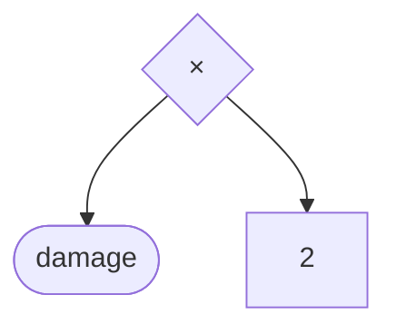

### `pipeline.area_evade_damage`

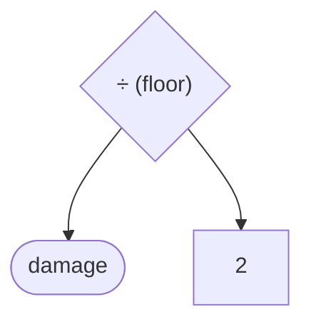

### `pipeline.evasion_rate`

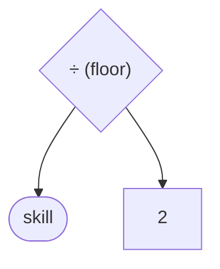

### `pipeline.dodge_evasion_rate`

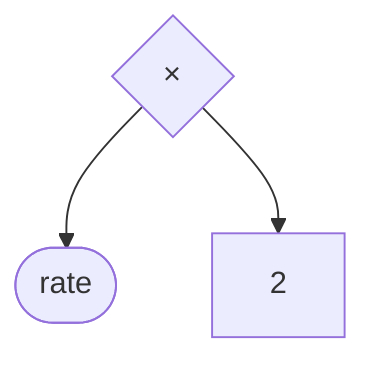

### `pipeline.block_rate`

### `pipeline.magic_block_rate`

### `pipeline.pierce_dr`

## `formulas/ap.json`

### `expression`

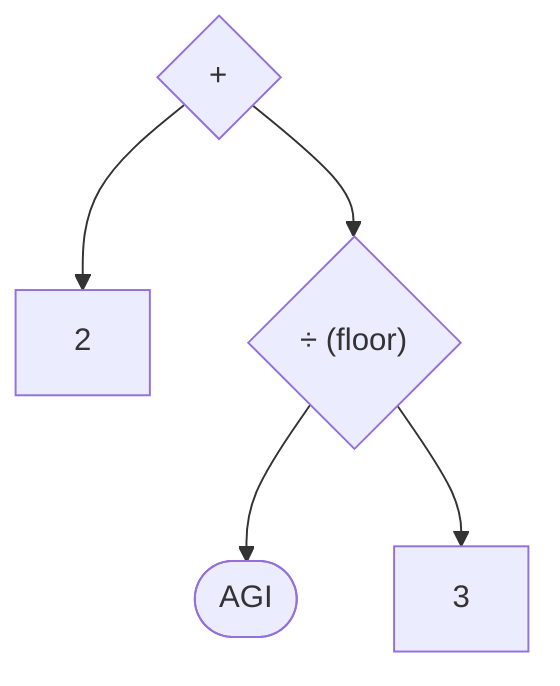

## `formulas/attribute_modifier.json`

### `expression`

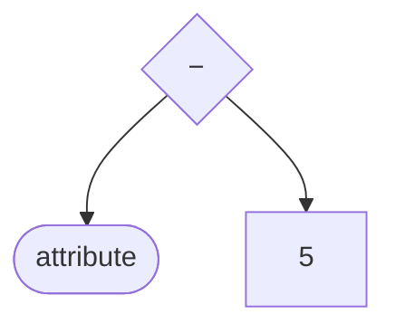

## `formulas/loot_luck.json`

### `expression`

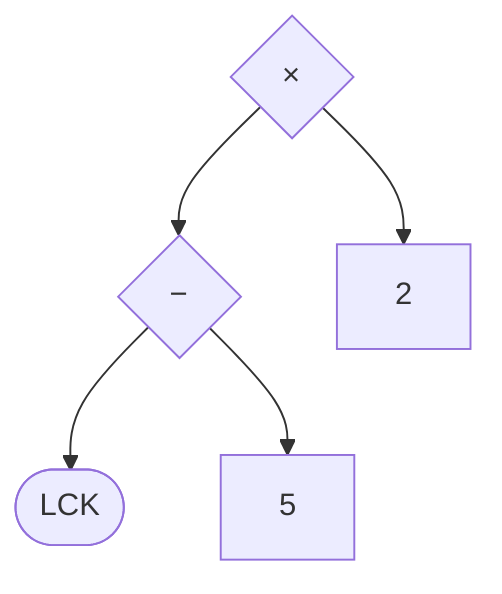

## `formulas/price.json`

### `expression`

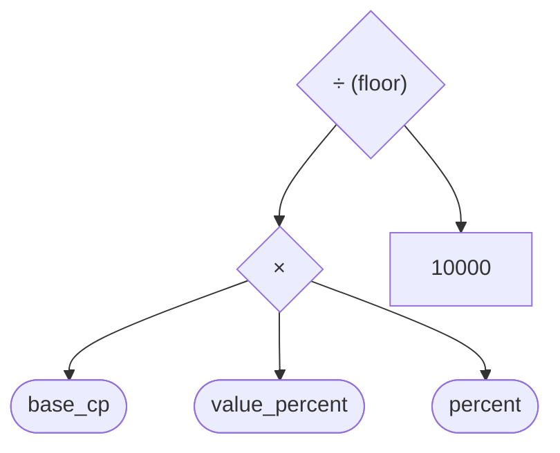

## `formulas/toxicity.json`

### `expression`

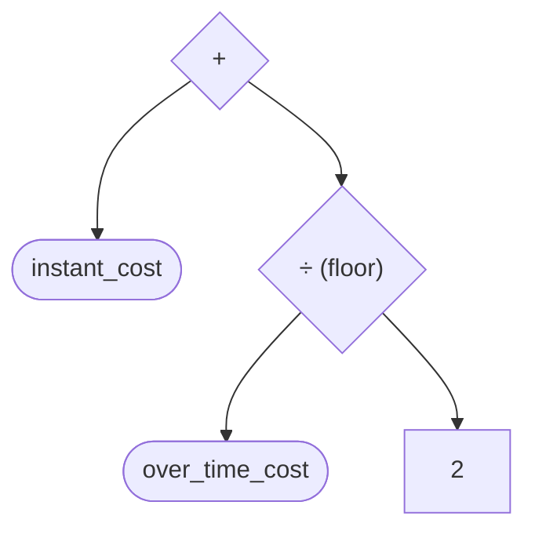

## `loot/core.json`

### `budget_cp`

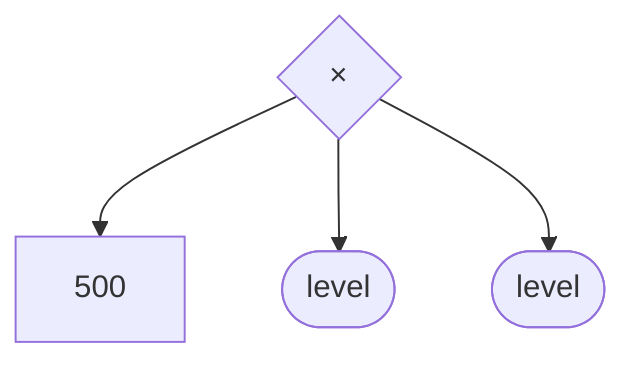

### `rolls_by_level`

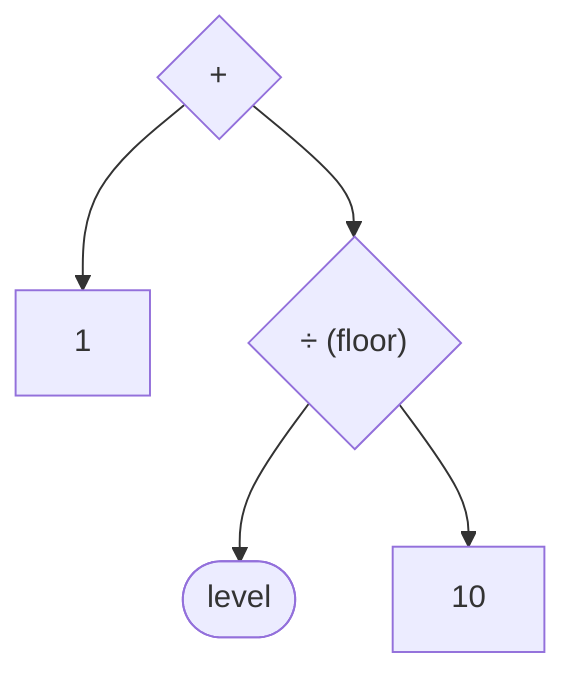

## `progression/core.json`

### `progression.xp_to_reach`

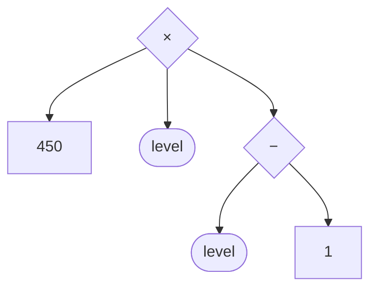

### `progression.skill_points`

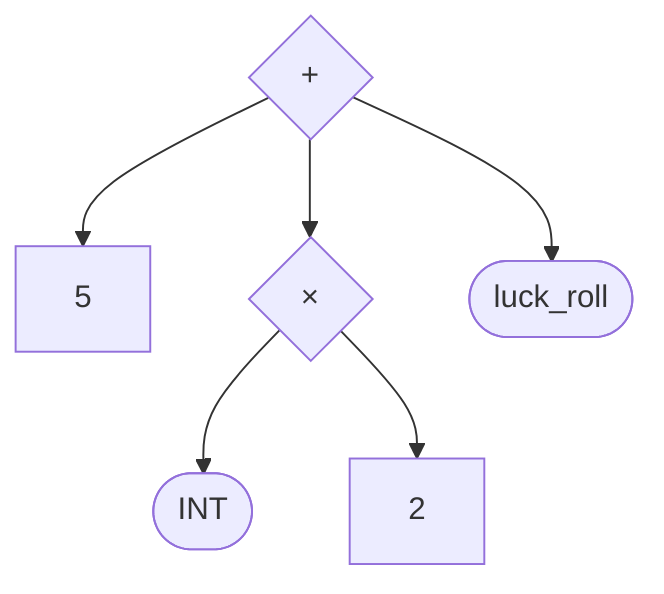

### `progression.pool_roll_max`

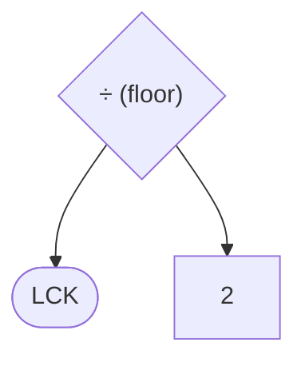

### `progression.skill_start`

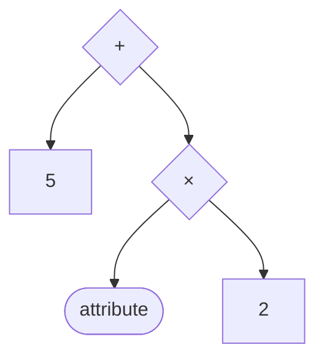
