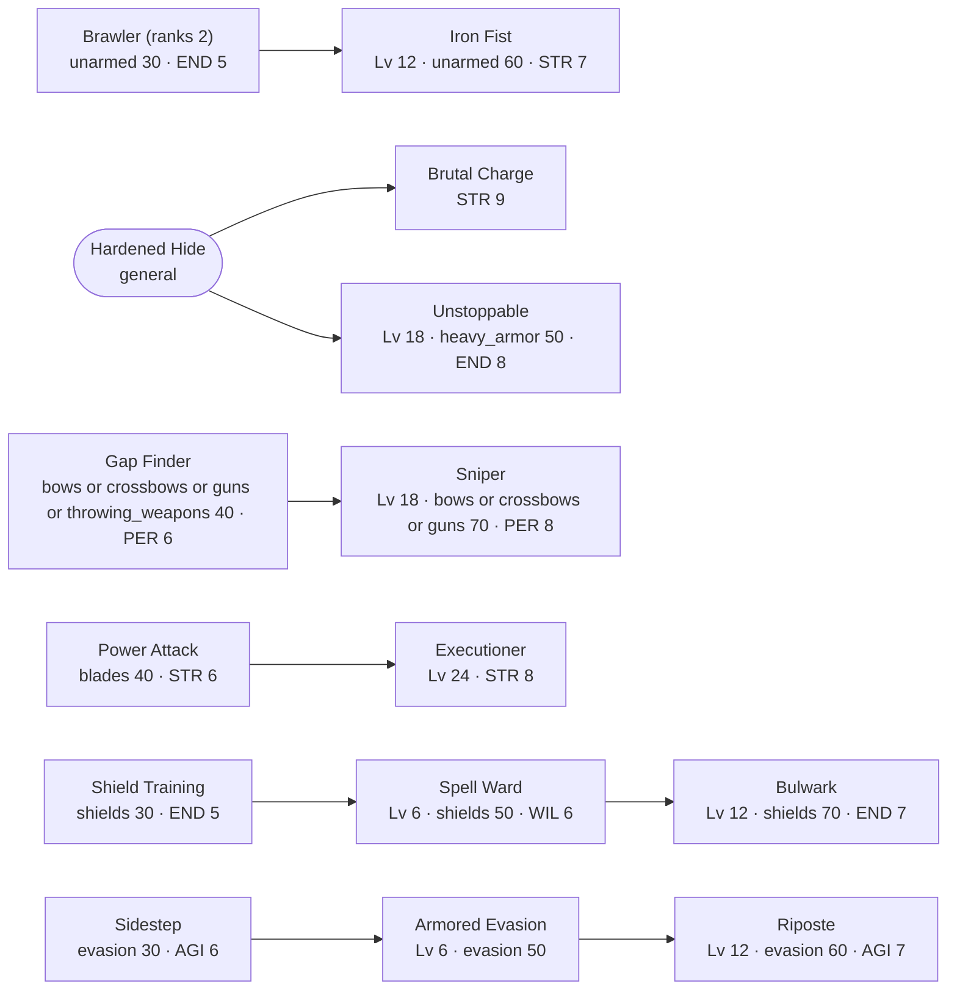
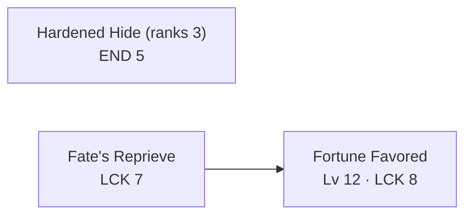
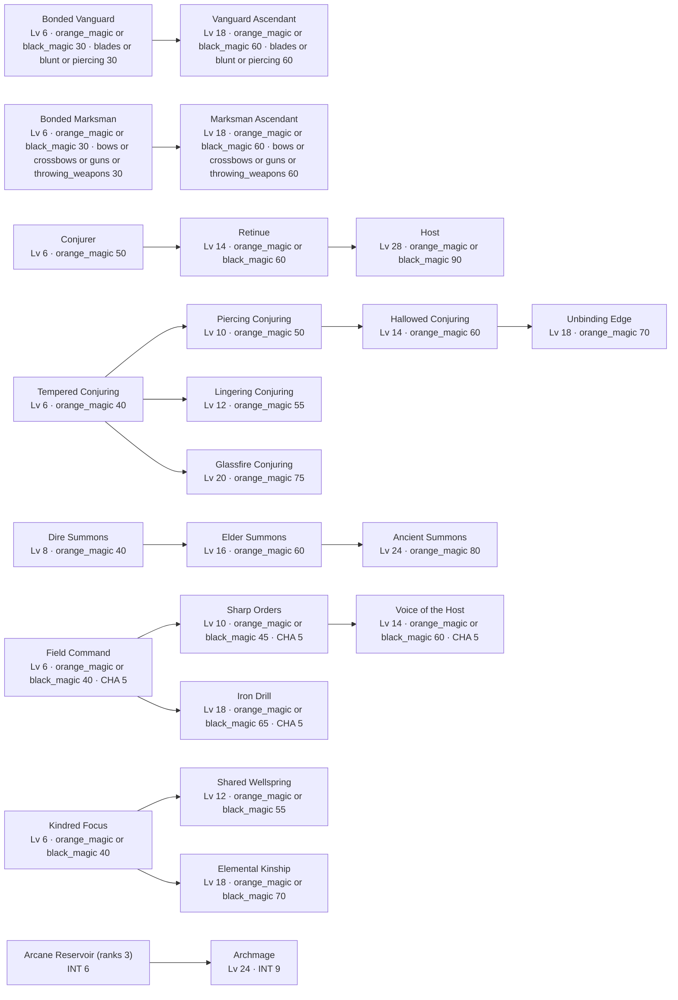
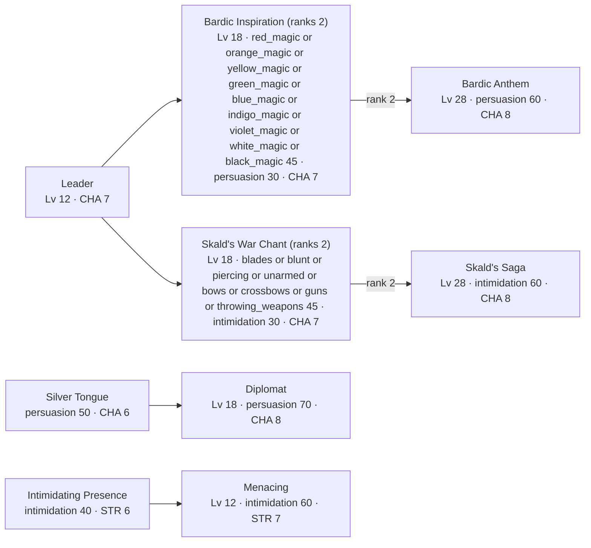
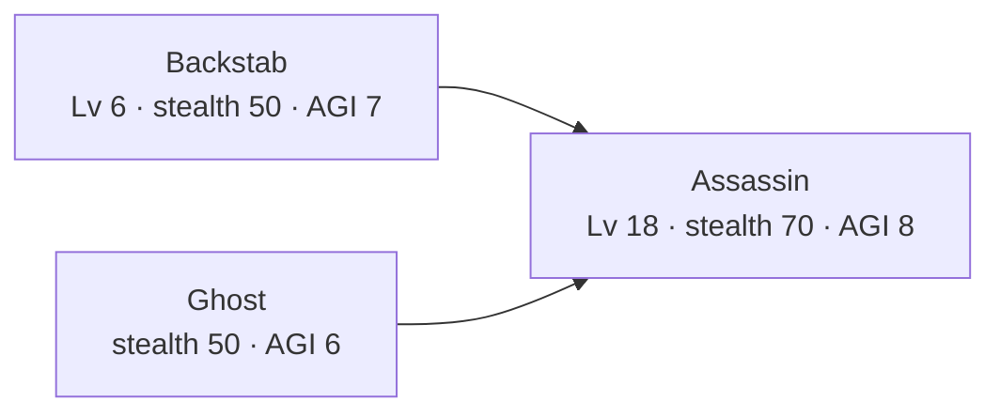

# Perk ladders

Modified: 2026-11-17

Generated by `ruleset/scripts/data_flowcharts.py` from `ruleset/data/features/core.json`; do not
edit by hand. Run `python ruleset/scripts/data_flowcharts.py --write` after a perk change, and
`test_data_flowcharts.py` fails until the page matches.

One chart per perk `category`. A box is a perk with its gates (level, skills, attributes); an
arrow runs from a prerequisite perk to the perk that needs it, labelled with the rank it needs
when more than 1. A rounded box is a prerequisite from another category. A ladder that stops
early, or a perk nothing leads to, shows at a glance.

117 perks: 54 on a ladder, 63 with no perk before or after them.

## Combat

## General

## Magic

## Social

## Stealth

## Perks on no ladder

No perk is required before them and none needs them; their gates are skills,
attributes, and level only.

| Perk | Category | Gates |
| --- | --- | --- |
| Ever Watchful | general | PER 6 |
| Shield Wall | combat | shields 40 · END 6 |
| Pyromancer | magic | red_magic 50 |
| Field Medic | survival | medicine 40 |
| Heavy Armor Expert | combat | heavy_armor 60 · STR 8 |
| Easy Stride | combat | light_armor 50 · AGI 7 |
| Wind-Up | combat | STR 5 |
| Snap Cut | combat | AGI 5 |
| Acrobat | combat | evasion 40 · AGI 7 |
| Scavenger | survival | LCK 6 |
| Cleave | combat | Lv 6 · blades or blunt 50 · STR 6 |
| Crushing Blow | combat | Lv 6 · blunt 50 · STR 7 |
| Precise Thrust | combat | Lv 6 · piercing 50 · AGI 6 |
| Ready Hand | combat | AGI 6 |
| Steady Aim | combat | Lv 6 · bows or crossbows or guns or throwing_weapons 40 · PER 6 |
| Duelist | combat | Lv 12 · blades 60 · AGI 7 |
| Catch Your Breath | combat | Lv 12 · END 7 |
| Berserker | combat | Lv 12 · STR 7 |
| Thrown Mastery | combat | Lv 12 · throwing_weapons 60 · AGI 7 |
| Fast Reload | combat | Lv 6 · crossbows 50 · STR 5 |
| Hip Shot | combat | Lv 12 · guns 60 · AGI 7 |
| Mana Flow | magic | Lv 6 · WIL 6 |
| Battle Mage | magic | Lv 12 · INT 6 · END 6 |
| Ward Breaker | magic | Lv 12 · INT 7 |
| Elemental Harmony | magic | Lv 18 · INT 6 · WIL 6 |
| Healer | magic | Lv 6 · green_magic 50 |
| Illusionist | magic | Lv 6 · yellow_magic 50 |
| Pincer Strike | magic | Lv 10 · orange_magic or black_magic 40 |
| Kindred Mind | magic | Lv 12 · orange_magic or black_magic 50 |
| Commanding Summons: Magic | magic | Lv 6 · orange_magic or black_magic 30 · CHA 6 |
| Commanding Summons: Physical | magic | Lv 6 · orange_magic or black_magic 30 · CHA 6 |
| Demonic Pact | magic | Lv 12 · orange_magic 50 |
| Angelic Covenant | magic | Lv 12 · orange_magic 50 |
| Otherworldly Call | magic | Lv 12 · orange_magic 50 |
| Transmuter | magic | Lv 6 · blue_magic 50 |
| Telekinetic | magic | Lv 6 · indigo_magic 50 |
| Unraveler | magic | Lv 6 · violet_magic 50 |
| Zealot | magic | Lv 6 · white_magic 50 · WIL 6 |
| Necromancer | magic | Lv 12 · black_magic 50 |
| Warded Mind | magic | Lv 12 · WIL 7 |
| Quick Caster | magic | Lv 18 · AGI 6 · INT 6 |
| Haggler | social | persuasion 30 · CHA 5 |
| Smooth Liar | social | deception 40 · CHA 6 |
| Empath | social | insight 40 · PER 6 |
| Streetwise | social | Lv 6 · CHA 5 |
| Trap Sense | stealth | investigation 40 · PER 6 |
| Light Fingers | stealth | sleight_of_hand 40 · AGI 6 |
| Locksmith | stealth | lockpick 40 · AGI 6 |
| Scholar | knowledge | lore 40 · INT 6 |
| Polyglot | knowledge | Lv 6 · INT 7 |
| Quick Learner | knowledge | INT 7 |
| Tracker | survival | survival 40 · PER 6 |
| Beast Friend | survival | animal_handling 40 · WIL 6 |
| Iron Stomach | survival | Lv 6 · END 7 |
| Pack Mule | general | STR 7 |
| Fleet-Footed | general | Lv 6 · AGI 7 |
| Tinkerer | utility | repair 40 · INT 6 |
| Master Alchemist | utility | Lv 12 · alchemy 60 · INT 7 |
| Master Smith | utility | Lv 12 · blacksmithing 60 · STR 6 |
| Unshaken | general | Lv 6 · WIL 7 |
| Meditative | magic | Lv 6 · WIL 6 |
| Night Eyes | survival | Lv 6 · PER 7 |
| Survivor | general | Lv 18 · END 6 · WIL 6 |
